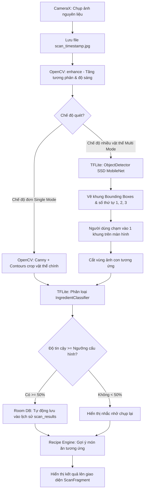

# BÁO CÁO BUỔI 6: KHẢO SÁT VÀ THIẾT KẾ DỰ ÁN
**Học phần:** Chuyên đề thiết kế ứng dụng thiết bị số  
**Đơn vị:** Trường Đại học Cửu Long (MKU)  
**Tên đề tài:** Ứng dụng gợi ý món ăn thông minh dựa trên nguyên liệu (SmartCook AI)  

---

## 1. Mô tả đề tài
Trong đời sống hiện đại, việc quyết định "Hôm nay ăn gì?" với những nguyên liệu sẵn có trong tủ lạnh luôn là nỗi băn khoăn của nhiều gia đình, sinh viên và người nội trợ. Ứng dụng **SmartCook AI** được phát triển nhằm giải quyết bài toán này bằng công nghệ Thị giác máy tính (Computer Vision) và Trí tuệ nhân tạo (AI) chạy trực tiếp trên thiết bị di động (Edge AI):
- Người dùng chỉ cần dùng camera điện thoại chụp/quét một hoặc nhiều nguyên liệu đang có (rau, củ, thịt, trứng, hải sản...).
- Hệ thống tự động nhận diện chính xác nguyên liệu, phân nhóm thực phẩm và lập tức đề xuất danh sách các món ăn Việt Nam truyền thống và hiện đại có thể chế biến ngay.
- Cung cấp công thức chi tiết, định lượng nguyên liệu, các bước nấu ăn và mẹo dinh dưỡng hữu ích.

---

## 2. Sơ đồ Use Case hệ thống

```mermaid
usecaseDiagram
    actor "Người Dùng (User)" as User

    package "SmartCook AI Mobile App" {
        usecase "UC01: Khởi động & Cấp quyền Camera" as UC01
        usecase "UC02: Quét nguyên liệu đơn (Single Mode)" as UC02
        usecase "UC03: Quét nhiều nguyên liệu (Multi Mode)" as UC03
        usecase "UC04: Chạm chọn Bounding Box nguyên liệu" as UC04
        usecase "UC05: Xem gợi ý món ăn & dinh dưỡng" as UC05
        usecase "UC06: Tra cứu công thức chi tiết" as UC06
        usecase "UC07: Quản lý lịch sử quét (Room DB)" as UC07
        usecase "UC08: Vuốt xoá lịch sử (Swipe to Delete)" as UC08
        usecase "UC09: Cấu hình ngưỡng tin cậy & chế độ ăn" as UC09
    }

    User --> UC01
    User --> UC02
    User --> UC03
    User --> UC04
    User --> UC05
    User --> UC06
    User --> UC07
    User --> UC08
    User --> UC09

    UC04 ..> UC05 : <<include>>
    UC02 ..> UC05 : <<include>>
    UC05 ..> UC06 : <<extend>>
    UC02 ..> UC07 : <<auto-save>>
```

---

## 3. Quy trình xử lý dữ liệu (Data Pipeline)



---

## 4. Thiết kế Wireframe giao diện (UI Architecture)

1. **Màn hình Splash (SplashActivity):**
   - Logo ẩm thực sang trọng, tên ứng dụng "SmartCook AI".
   - Hộp thoại xin cấp quyền CAMERA khi vừa mở ứng dụng.

2. **Màn hình Quét ảnh (ScanFragment):**
   - Phía trên: Khung hướng dẫn góc chụp, ánh sáng tốt.
   - Trung tâm: Khung ngắm CameraX toàn màn hình.
   - Phía dưới: Nút Chụp ảnh (Capture) + Nút Chuyển chế độ Nhiều nguyên liệu (Multiple items: ON/OFF).
   - Khi đã chụp: Lớp phủ (Overlay) gồm dải màu phân loại, Tên nguyên liệu, Độ tin cậy %, Gợi ý món ăn và Nút "Xem công thức chi tiết".

3. **Màn hình Lịch sử (HistoryFragment):**
   - RecyclerView dạng CardView bo góc: Hình thumbnail nguyên liệu, Tên món, Nhóm nguyên liệu, Ngày giờ quét, % Độ tin cậy.
   - Thao tác vuốt sang trái/phải để xóa nhanh khỏi Room Database.

4. **Màn hình Gợi ý món ăn (RecipesFragment):**
   - Thanh tìm kiếm món ăn hoặc nguyên liệu theo thời gian thực.
   - Danh sách thẻ món ăn: Thời gian nấu (phút), Độ khó, Lượng calo, Badge "Khớp nguyên liệu".
   - Nhấn vào thẻ để mở BottomSheet hiển thị chi tiết các bước nấu ăn.

5. **Màn hình Cài đặt (SettingsFragment):**
   - Thanh trượt điều chỉnh ngưỡng tin cậy nhận diện AI (10% - 90%).
   - Tùy chọn ưu tiên món ăn chay / thanh đạm.
   - Nút xóa toàn bộ lịch sử quét.
